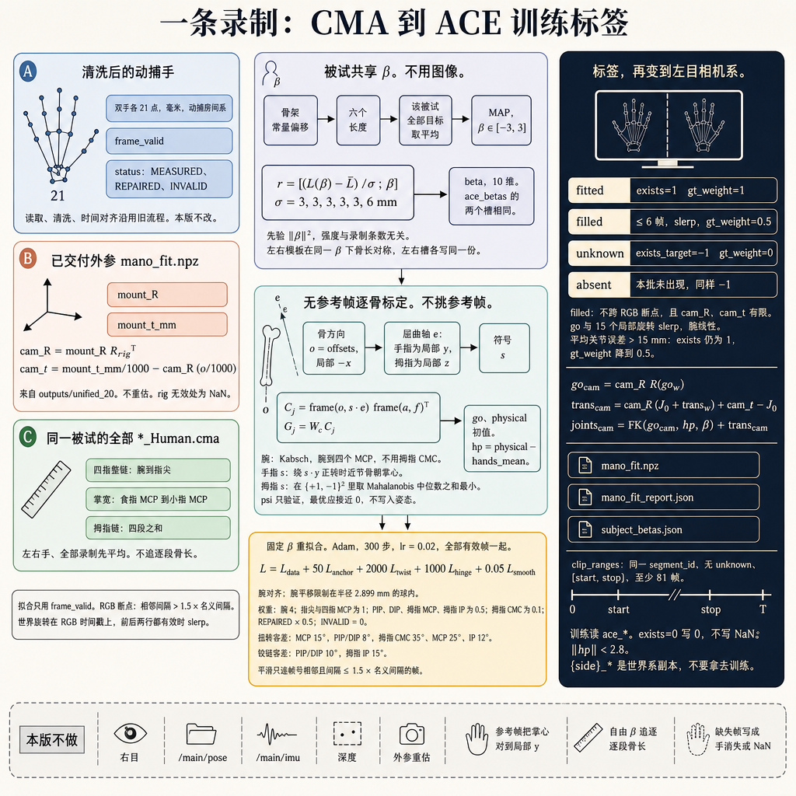

# CMA2MANO

把 CMA 动捕手套的一条录制，变成 ACE-Ego-Hand 能直接训练的 MANO 标签。读取、清洗和时间对齐沿用 `robust_convert/`；本版改的是形状、逐骨标定、固定 beta 重拟合，以及会进损失的存在性标签。相机外参不重估。20 条录制的结果在 `results/`。



一条录制从左到右走完：三路输入、共享形状与逐骨标定、固定 beta 重拟合、再变到左目相机系写出训练标签。

## 算法全流程

入口是 `python -m gt_fix.convert`。一条录制在 `gt_fix.convert.convert_recording` 里按下面的顺序处理。

### 1. 三路输入

**A. 清洗后的动捕手**（`robust_convert.session.load_session`，本版不改）

双手各 21 个点，单位毫米，在动捕房间系。每帧带 `frame_valid`，每个关节带 `status`：`MEASURED`、`REPAIRED`、`INVALID`。拟合只用 `frame_valid` 的帧。

**B. 已交付外参**（`mano_fit.npz` 里的 `mount_R`、`mount_t_mm`）

来自已经评估过的 `outputs/unified_20`，这里不重估。世界系到左目相机系：

```text
cam_R = mount_R @ R_rig^T
cam_t = mount_t_mm / 1000 - cam_R @ (origin_mm / 1000)
```

`rig` 无效的帧，`cam_R` 和 `cam_t` 写成 NaN。

**C. 同一被试的全部 `*_Human.cma`**

形状不用图像，也不追逐 CMA 的逐段骨长。每只手只取六个长度：四指各自的腕到指尖整链、掌宽（食指 MCP 到小指 MCP）、拇指四段之和。左右手、该被试的全部录制先平均。

时间对齐也沿用旧流程，并在两处收紧：

- RGB 断点：相邻帧间隔大于名义间隔的 1.5 倍。
- 世界旋转重采样到 RGB 时间戳：前后两行都有效时做 slerp，不再取最近一行。

### 2. 被试共享 beta

`gt_fix.shape`。左右手、该被试的全部录制共用一组 10 维 beta，左右槽各写同一份。

骨架常量偏移先收成上面六个长度，再对该被试全部目标取平均，解一个带标准正态先验的 MAP，约束在 `[-3, 3]`：

```text
r = [(L(beta) - L_bar) / sigma ; beta]
sigma = 3, 3, 3, 3, 3, 6 mm
```

前五个长度的容差是 3 mm，拇指链是 6 mm（CMA 的拇指根骨 T0→T1 在所有人身上都是 30 mm）。先验是 `||beta||^2`，权重与这个被试有几条录制无关，所以录制多不会把 beta 拉得更狠。MANO 左右模板在同一 beta 下骨长对称。

### 3. 无参考帧逐骨标定

`gt_fix.calibrate`。不挑参考帧，也不再把 MANO 掌心对到 CMA 的局部 y 轴——那根轴就是手指的屈曲轴，对上去会把每根手指拧大约 90°。

每根骨用骨架常量对齐：

```text
C_j = frame(o, s · e) @ frame(a, f)^T
G_j = W_c @ C_j
```

- `o`：CMA 骨方向，取常量偏移，在父骨局部系是 −x。
- `e`：CMA 屈曲轴。四指是局部 y，拇指是局部 z。
- `a`、`f`：MANO 模板骨方向和屈曲轴。正转表示屈曲。
- `s`：符号。四指看绕 `s·y` 正转时近节骨是否朝掌心；拇指在 `{+1, −1}^2` 里取 Mahalanobis 中位数之和最小的一对。
- 手腕：Kabsch，对齐腕到四个手指 MCP 的方向，不用拇指 CMC。

整条链再绕骨轴附加的扭转偏置 `psi` 只用来验证。新标定的最优 `psi` 应接近 0，不写进姿态。标定给出全局朝向 `go` 和物理姿态初值，残差是 `hp = physical − hands_mean`（`flat_hand_mean=False`）。

### 4. 固定 beta 重拟合

`gt_fix.fit`。beta 冻住，全部有效帧一起用 Adam 优化 300 步，学习率 0.02。初值来自上一节的标定。

```text
L = L_data + 50 L_anchor + 2000 L_twist + 1000 L_hinge + 0.05 L_smooth
```

- `L_data`：MANO 关节对 CMA 关节。腕先对齐，腕平移限制在半径 2.899 mm 的球内。权重：腕 4；指尖和四指 MCP 为 1；PIP、DIP、拇指 MCP、拇指 IP 为 0.5；拇指 CMC 为 0.1。`REPAIRED` 再乘 0.5，`INVALID` 为 0。
- `L_anchor`：物理轴角靠近标定初值。位置约束不到的自由度，尤其是末节扭转，留在手套测到的值。
- `L_twist`：绕骨轴扭转超过容差的部分。MCP 15°，PIP/DIP 8°，拇指 CMC 35°、MCP 25°、IP 12°。
- `L_hinge`：PIP/DIP 偏离屈曲轴超过 10°、拇指 IP 超过 15° 的部分。
- `L_smooth`：只连接帧号相邻、且间隔不超过名义间隔 1.5 倍的帧。

### 5. 标签，再变到左目相机系

`gt_fix.labels`。每只手每帧四种状态：

| 状态 | 含义 | exists | 建议权重 |
|---|---|---:|---:|
| `fitted` | CMA 有效，重拟合得到 | 1 | 1 |
| `filled` | 内部短空洞，不超过 6 帧，slerp | 1 | 0.5 |
| `unknown` | 开头、结尾、过长或跨断点的缺失。给不出可信姿态，也不能说手不在 | `exists_target = -1` | 0 |
| `absent` | CMA 文件里没有这只手。本批没有出现，同样记 −1 | `exists_target = -1` | 0 |

`filled` 不跨 RGB 断点，并且 `cam_R`、`cam_t` 必须有限。全局朝向和 15 个局部旋转做 slerp，腕位置线性插值。平均关节误差超过 15 mm 的帧手仍在，`exists` 仍为 1，建议权重降到 0.5。

世界系姿态变到左目相机系：

```text
go_cam = cam_R @ R(go_w)
trans_cam = cam_R @ (J0 + trans_w) + cam_t − J0
joints_cam = FK(go_cam, hp, beta) + trans_cam
```

每条录制写出 `results/<录制>/mano_fit.npz` 和 `mano_fit_report.json`，全部被试的形状在 `results/subject_betas.json`。

训练片段 `clip_ranges` 是半开区间 `[start, stop)`：同一 `segment_id`、没有 `unknown`、至少 81 帧。训练读 `ace_*`。`exists = 0` 的位置写 0，不写 NaN。残差轴角满足 `||hp|| < 2.8`。带 `{side}_*` 前缀的数组是世界系副本，不要拿去训练。

### 6. 本版不做

右目，`/main/pose`，`/main/imu`，深度，外参重估，参考帧把掌心对到局部 y，自由 beta 追逐逐段骨长，以及把缺失帧写成“手消失”或 NaN。

## 旧标签里会直接进损失的问题

审计 `audit/before`（7051 帧，5451 个 81 帧窗口）：

| 问题 | 旧结果 | 训练时发生什么 |
|---|---:|---|
| 手指绕骨轴扭转超标 | 14083 帧，40 只手全中 | 指根扭转的 p95 中位约 100°。位置拟合约束不住绕骨轴的滚转，屈曲被写成侧弯，网格是拧着的 |
| beta 贴 ±3 | 40/40 只手，左右手 L2 平均 2.36 | 同一只手在不同录制、左右手之间形状都不一样。CMA 的逐段骨长不符合解剖（掌短指长，拇指根骨恒为 30 mm），自由 beta 只能顶到边界 |
| exists=0 但手里其实有 | 19 帧，其中 7 帧是内部空洞 | ACE 的 presence 损失把这些帧学成“手消失了”。125531 左手 [146,149)、164514 右手 [223,227)、112346 右手开头 [0,12) |
| 这些帧的参数是 NaN | 19 帧，179 个窗口含 NaN | `masked_mean` 是 `sum(x*m)/sum(m)`，NaN×0 仍是 NaN，一个窗口就能让 loss 变成 NaN |
| 81 帧窗口跨 RGB 断点 | 219 个窗口 | 断点两侧隔了 67–300 ms，训练却把它们当成相邻帧 |
| 残差轴角接近 π | 1 帧 | 旋转矩阵和轴角往返会改姿态。ACE 要求 \|hp\| < 2.8 |

相对 CMA 关节的平均距离是 6.93 mm，和 MediaPipe 的中位像素误差是 9.19 px（CMA 自己是 8.65 px）。毫米数好看，是因为优化目标就是贴 CMA，贴的过程把扭转和畸形骨长一起学进去了。

## 修了什么

`gt_fix/` 在旧的读取、清洗和时间对齐之后接手：

1. **逐骨标定**（`calibrate.py`）。不再用“参考帧上把 MANO 掌心对到 CMA 的 y 轴”——CMA 手指的局部 y 轴就是屈曲轴，那样对会把每根手指拧大约 90°。现在用骨架常量把 CMA 的骨方向和屈曲轴映到 MANO 的骨方向和屈曲轴，不挑参考帧。
2. **每个被试一组 beta**（`shape.py`）。左右手、该被试的全部录制共用。只拟合整指链长、掌宽和拇指链长，不追逐 CMA 把掌骨切短、指骨切长的那段误差。先验是标准正态，所以不会因为某被试录制多就把 beta 拉得更狠。本批 \|β\| 最大分量：ld 0.58，lxy 0.99，zyx 1.39，yym 1.75，没有贴边界。
3. **固定 beta 重拟合**（`fit.py`）。初值来自标定。数据项仍是 MANO 关节对 CMA 关节，但拇指 CMC 权重 0.1，PIP/DIP 权重 0.5，指尖和 MCP 权重 1：MediaPipe 对照里，CMA 的指尖和 MCP 与图像最接近，拇指根和中间关节受畸形骨长影响。另加扭转、铰链、标定锚点和连续帧平滑。
4. **标签状态**（`labels.py`）。每只手每帧：
   - `fitted`：CMA 有效，重拟合得到。exists=1，建议权重 1
   - `filled`：内部短空洞（≤ 6 帧，不跨 RGB 断点，相机位姿已知），用两端 slerp 插值。exists=1，建议权重 0.5
   - `unknown`：录制开头/结尾的缺失、过长的空洞、跨断点的空洞。给不出可信姿态，也不能说手不在。exists=0，`exists_target=-1`，权重 0，并且任何含它的帧都不进训练片段
   - `absent`：CMA 文件里没有这只手。本批没有出现，同样 `exists_target=-1`

   exists=0 的 `ace_*` 数组写 0，不写 NaN。平均关节误差超过 15 mm 的帧手仍在，建议权重降到 0.5；本批没有这种帧。

## 修复后

审计 `audit/after`，同一套阈值：

| 指标 | 修复前 | 修复后 |
|---|---:|---:|
| 扭转超标帧 | 14083 | 0 |
| beta 贴边界的手 | 40 | 0 |
| 左右 beta 的 L2 | 2.36 | 0 |
| 缺失帧里的 NaN | 19 | 0 |
| 含 NaN 的 81 帧窗口 | 179 | 0 |
| 内部空洞（exists 掉下去） | 7 帧 | 0（3 帧和 4 帧两处都补上了） |
| 被声明为“手不在”的帧 | 19 | 0 |
| 训练窗口自相矛盾 | — | `window_ok` 5222，其中坏窗口 0 |
| 残差 ≥ 2.8 rad 的帧 | 1 | 0 |
| 局部旋转跳变帧 | 13 | 8 |
| 相对 CMA 的平均距离 | 6.93 mm | 7.32 mm |
| 相对 MediaPipe 的中位误差 | 9.19 px | 8.62 px（CMA 本身 8.65 px） |

112346 右手开头 12 帧仍是 `unknown`：录制一开始 CMA 就没跟上，没有更早的拟合帧可以插值。这 12 帧 `exists_target=-1`，presence 损失应忽略，对应的训练片段从第 12 帧开始。画面里看得到手，所以不能把它们标成“手不存在”。

直接在整段录制上滑 81 帧，仍有 219 个窗口跨 RGB 断点、12 个窗口擦到这 12 帧。`clip_ranges` 和 `window_ok` 已经把它们排除。`windows_sampler_ok_but_bad = 0`。

## 交给 ACE 时怎么用

`results/<录制>/mano_fit.npz` 里训练用 `ace_*`，不要用带 NaN 的 `{side}_*`（那是和旧交付对齐的世界系副本）。

| 键 | 形状 | 含义 |
|---|---|---|
| `ace_exists` | (T,2) | 1 = 有姿态（fitted 或 filled）。槽位 0 左、1 右 |
| `exists_target` | (T,2) int8 | 1 或 -1。-1 的帧不要进 presence 损失。本批没有 0 |
| `gt_weight` | (T,2) | fitted 1，filled 0.5，unknown/absent 0 |
| `gt_state` | (T,2) int8 | 0 fitted，1 filled，2 unknown，3 absent |
| `ace_go` `ace_hp` `ace_trans` | (T,2,3) (T,2,45) (T,2,3) | 相机系。`hp` 是残差，物理姿态 = hp + hands_mean（`flat_hand_mean=False`） |
| `ace_betas` | (2,10) | 该被试的共享形状，左右槽各一份相同的 beta |
| `ace_joints_cam` | (T,2,21,3) 米 | 由上面的参数做前向运动学得到，误差约 1e-5 mm |
| `ace_joints2d` | (T,2,21,2) | 用原图像宽高归一化。exists=0 时为 0 |
| `ace_joint_vis` `ace_visible` | (T,2,21) (T,2) | 投影在画面内、深度 > 1 cm，且 exists=1 |
| `clip_ranges` | (C,2) | 半开区间 [start, stop)。同一时间段、没有 unknown、至少 81 帧 |
| `window_ok` | (T,) | 从这一帧开始的 81 帧可以训练 |
| `segment_id` `gap_after` | (T,) | RGB 断点。断点两侧不要当成相邻帧 |

建 clip 之前先按 `clip_ranges` 切开。一个 ACE `.pt` 对应一段连续视频。不要把 `exists_target=-1` 的帧当成负样本。

自检已经写在每条 `mano_fit_report.json` 的 `checks` 里：`ace_*` 有限、残差 < 2.8、前向运动学能复现 `ace_joints_cam`、相机矩阵与旧交付一致、exists=0 的位置是 0 而不是 NaN。

## 为什么对 CMA 的毫米数变大了

7.32 mm 对 6.93 mm，是拟合目标变了，不是手漂了。

旧拟合把每个关节都往 CMA 上拉，beta 自由。CMA 的掌骨比 MANO 短 10–25 mm、中节指骨可以短到 11 mm，拇指 T0→T1 在所有人身上都是 30 mm。这些长度对不上时，唯一的出路是把 beta 顶到 ±3，再让手指绕骨轴滚转：关节中心还能靠近，网格已经拧了。MediaPipe 看到的是网格该在的图像位置，所以旧 MANO 的像素误差（9.19 px）比 CMA 自己（8.65 px）还差。

新拟合的 beta 只跟整条指链的长度走，PIP/DIP 和拇指 CMC 的位置权重降低，扭转被拉回 MANO 训练姿态的范围（指根 p95 从约 100° 降到约 15°，MANO 参照大约 20–40°）。关节中心因此离 CMA 稍远，投影反而和 MediaPipe 对齐到与 CMA 同一水平（8.62 px）。指尖在调参记录里是变近的：位置误差从初值的数毫米降到大约 1–4 mm，让出来的是 CMA 本来就不可信的那段骨。

171800 左手、171819 右手的像素误差仍然有 15 px 上下。这两只手修复前也一样高，CMA 投影本身就高，来自外参和遮挡，不是这一版姿态修复能消掉的。

## 短空洞补到哪一帧为止

`figures/holdout.png` 是留出实验：在完整拟合段里挖掉 L 帧，用两端插值，再和真实拟合比。40 只手的中位数：

| 挖掉帧数 | 关节误差均值 | p95 | 去掉手腕后的均值 |
|---:|---:|---:|---:|
| 3 | 0.68 mm | 2.3 mm | 0.31 mm |
| 4 | 0.93 mm | 3.3 mm | 0.41 mm |
| 6 | 1.57 mm | 5.7 mm | 0.61 mm |
| 10 | 3.3 mm | 12.4 mm | 1.0 mm |

本批真的缺测只有两处，3 帧和 4 帧，都在这条线的左侧。6 帧是上限：再长，快动作的尾部会到厘米级（125531 左手挖 6 帧时均值约 7 mm、p95 约 25 mm），那种段标成 `unknown` 而不是插值。补上的帧权重 0.5。

## 图和视频

`figures/`：

| 文件 | 内容 |
|---|---|
| `scoreboard.png` | 上表的比例 |
| `timeline.png` | 20 条录制的逐帧状态、训练片段和 RGB 断点 |
| `beta.png` | 形状系数，修复前贴 ±3，修复后按被试成块 |
| `twist.png` | 15 个关节的扭转 p95，对照 MANO 训练姿态 |
| `image_agreement.png` | 每只手相对 MediaPipe 的像素误差：CMA、旧 MANO、新 MANO |
| `temporal.png` | 局部旋转跳变和根相对加速度，点在对角线下方更稳 |
| `holdout.png` | 插值误差随空洞长度 |
| `closeup_*.png` | 每个被试一张张开且完整入画的手，左旧网格、右新网格 |
| `film_*.png` | 三处存在性缺陷前后的胶片 |
| `video_*.mp4` | 112346、125531、164514。从左到右：CMA、旧 MANO、新 MANO |

胶片和视频里，旧标签在空洞处写着 `ABSENT`，新标签写着 `filled` 或（112346 开头）`unknown`。

## 怎么重跑

原始录制目录和已交付外参目录写在 `gt_fix/convert.py` 的 `RAW`、`OLD`。转换需要带 torch 的解释器；统计图需要 matplotlib。下面是在本机上的命令。

```powershell
cd C:\Users\11068\Desktop\mano线推进\convert_last_version
$env:PYTHONIOENCODING = 'utf-8'
& C:\Users\11068\miniconda3\envs\ace-ego-hand\python.exe -W ignore -m gt_fix.convert --workers 4
& C:\Users\11068\miniconda3\envs\ace-ego-hand\python.exe -W ignore audit_gt.py --results results --out audit/after
& C:\Users\11068\AppData\Local\Programs\Python\Python312\python.exe -W ignore tools\make_figures.py
& C:\Users\11068\miniconda3\envs\ace-ego-hand\python.exe -W ignore tools\make_views.py
```

`gt_fix.convert --only <录制名>` 只重做列出的录制，并保留 `results/summary.json` 里其余条目。

## 局限

- 形状只吸收整指长度。CMA 把 MCP 切向手腕、指骨切长的那部分仍然在，所以相对 CMA 的 MCP 误差会留在 1–2 cm。这是手套骨架的问题。
- 拇指 CMC 的测量是常数 30 mm，拟合权重 0.1，扭转容差 35°。修完后拇指根的 p95 大约 36°，MANO 训练姿态在这个关节上本身就到约 48°。
- beta 是每个被试一个，不是每帧一个。换了人要重估 `results/subject_betas.json`。
- 外参没有重估。图像上剩下的十几个像素，先看 `outputs/unified_20` 的外参报告。
- `unknown` 不是“手不在画面里”。本批没有真正的缺手，不要把 -1 当成 presence 的负类。
- RGB 断点不插值。训练片段在断点处切开，断点两侧的时间间隔写在报告的 `time_gaps` 里。
